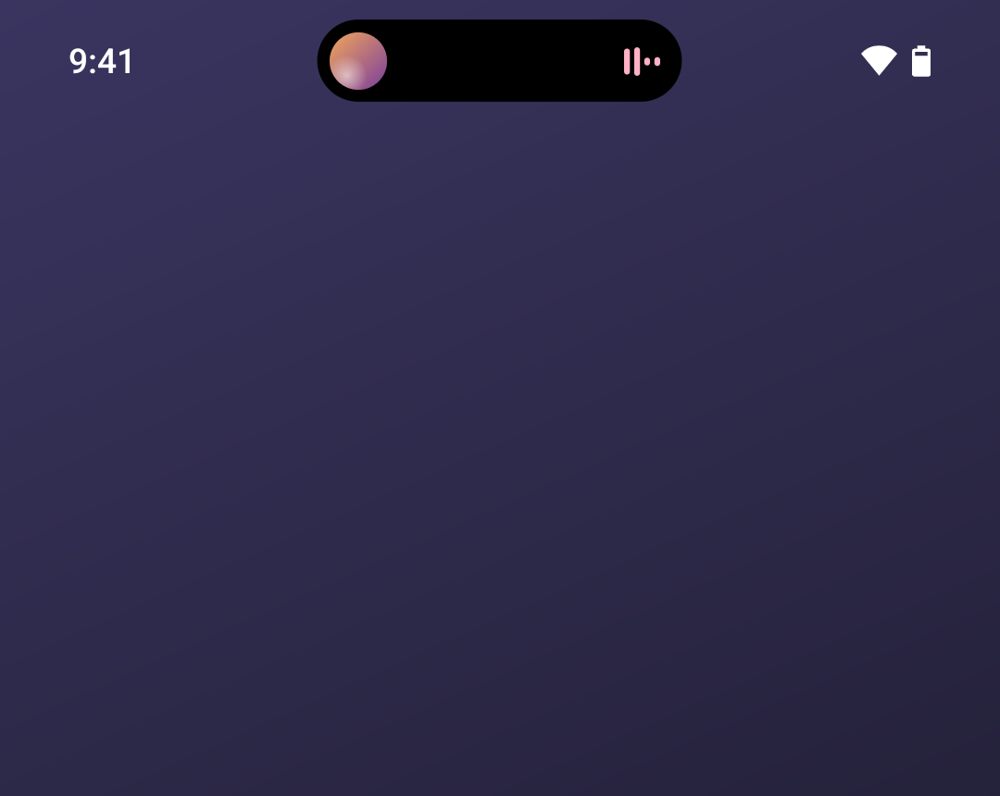
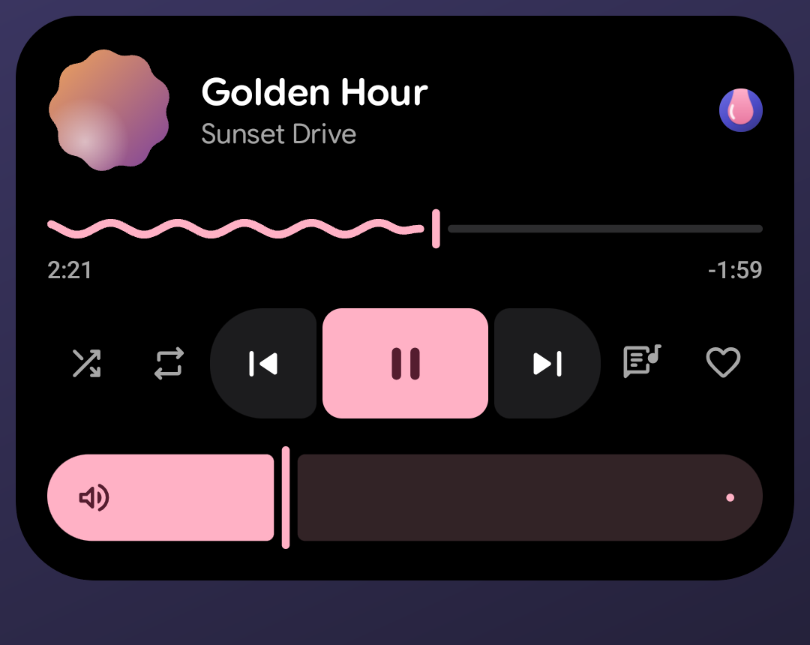
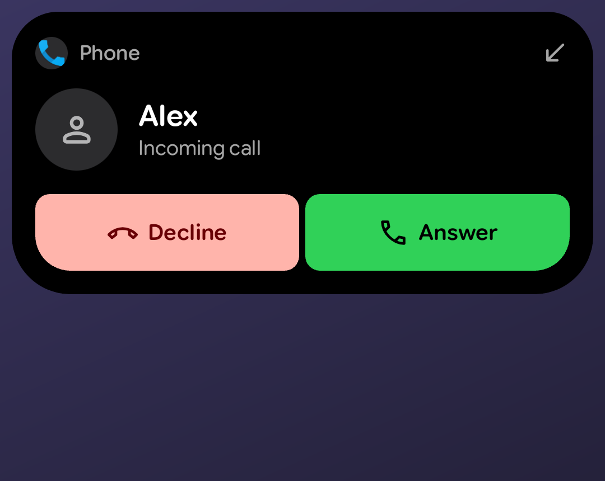
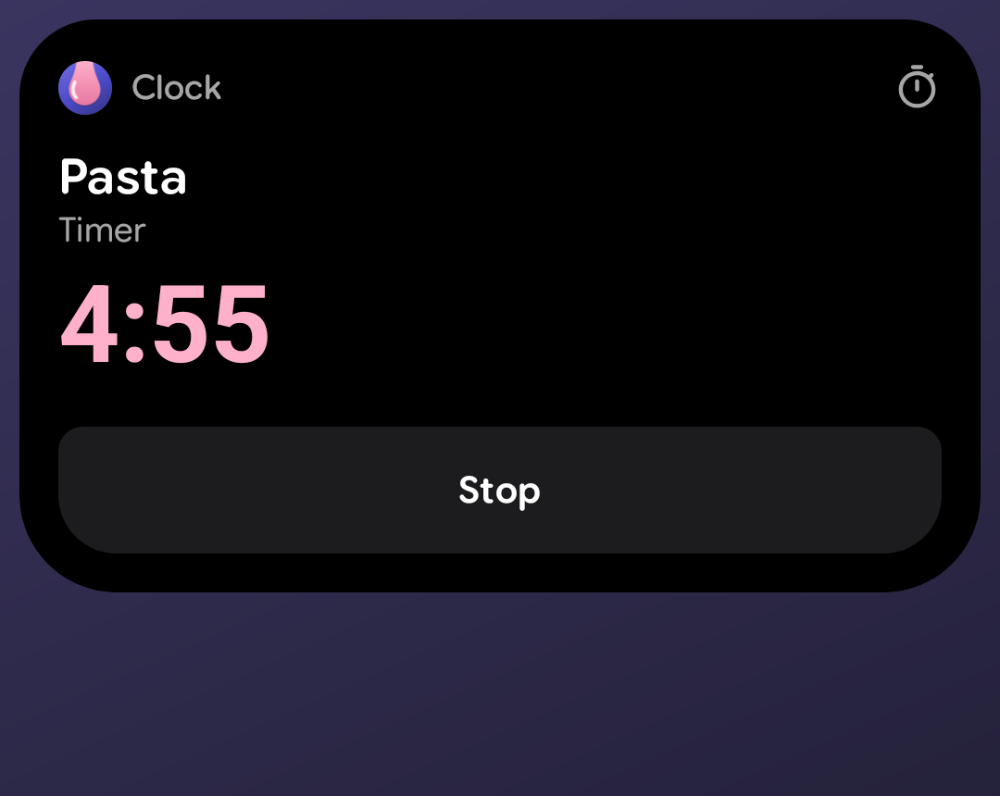
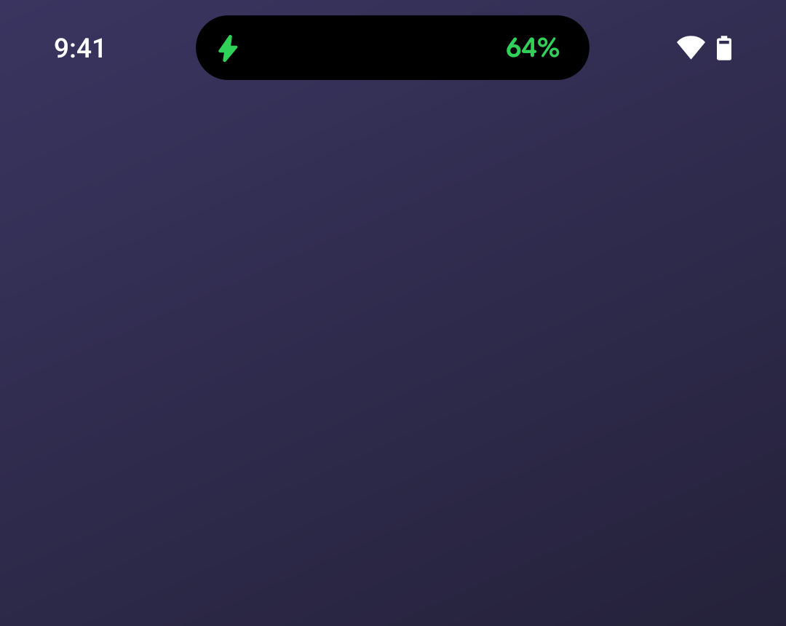

# Drip

[](https://github.com/Marukiee/Drip/releases/latest)
[](LICENSE)
[](#installeren)

[English](README.md) | Nederlands

**Een dynamic island voor Android.** Muziek, gesprekken, timers, live updates en meldingen verschijnen in één pil bovenaan je scherm. Hij gaat open met een tik en beweegt op veren met de verversingssnelheid van je scherm, met haptiek die stijgt als hij opengaat en daalt als hij sluit.

De vorm komt van je telefoon: het cameragat, de statusbalk en de hoekstraal van je scherm, zodat een geopend eiland een gelijke rand houdt tot aan de ronde schermrand. Op een telefoon met cameragat, zoals de Pixel 10, is het een pil om de camera. Op een telefoon zonder gat, zoals de Sony Xperia 1 VI, is het een notch die aan de bovenrand hangt.

## Screenshots

<p>
  
  
  
</p>
<p>
  
  
</p>

## Wat het doet

- **Muziek.** Hoes, een golvende voortgangslijn, bediening en een volumebalk
- **Gesprekken.** Opnemen en ophangen vanaf het eiland
- **Live updates.** Timers, ritten, bezorgingen en andere updates van je apps
- **Opladen en zaklamp.** De laadstatus, en de zaklamp met zijn sterkte
- **Meldingen.** Op het eiland, met de camera- en microfoonstippen als een app ze gebruikt
- **Korte aankondigingen.** Volume, beltoon, niet storen, schermrotatie, batterijbesparing, koptelefoon en meer
- **Eigen acties.** Tik om te openen, veeg omhoog of tik ernaast om te sluiten, houd vast of veeg voor acties die je zelf kiest
- **Niet in de weg.** Hij laat niets zien als er niets te zien is en gaat opzij in apps op volledig scherm

## Installeren

1. Download `Drip.apk` van de [nieuwste release](https://github.com/Marukiee/Drip/releases/latest) op je telefoon.
2. Open het bestand. Android vraagt één keer of de app waarmee je het opent (je browser of bestanden-app) apps van onbekende bronnen mag installeren. Zet dat aan, ga terug en tik op Installeren.
3. Open Drip en volg de stappen om de twee rechten hieronder te geven.

Daarna heb je GitHub nooit meer nodig: de app werkt zichzelf bij vanuit de releases. Je kunt de repository ook in [Obtainium](https://obtainium.imranr.dev) zetten.

### Waar Drip om vraagt

- **Toegankelijkheidsdienst.** De enige manier waarop een app boven de statusbalk mag tekenen. Drip gebruikt hem voor het eiland, de gebaren, en om te zien waar vensters staan zodat hij opzij gaat in apps op volledig scherm. In een muziekapp die speelt zoekt hij ook de zoekbalk en de titel van het nummer, zodat het eiland plaats kan maken voor de eigen speler van die app. Hij leest verder niets op het scherm en bewaart niets
- **Toegang tot meldingen.** Voor muziek, gesprekken en live updates

Er verlaat niets de telefoon.

## Bouwen

Je hebt JDK 21 en de Android SDK nodig.

```sh
./gradlew :app:assembleDebug
```

## Licentie

AGPL-3.0, zie [LICENSE](LICENSE). Gemaakt door Mark Maakt Media.
